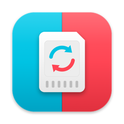
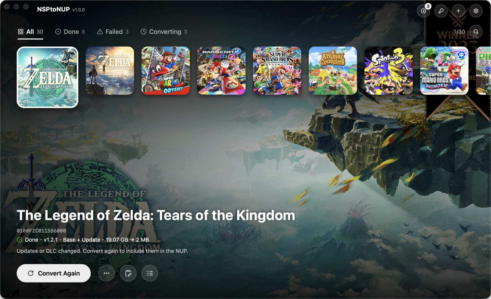
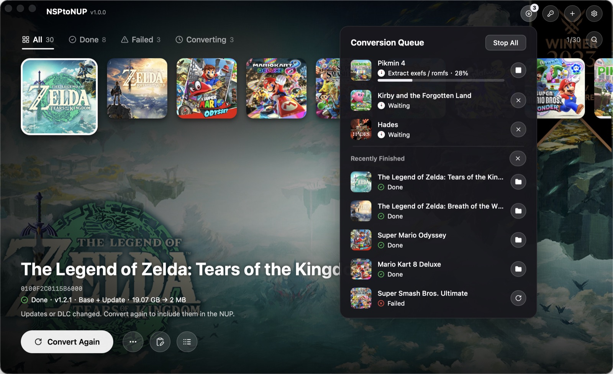
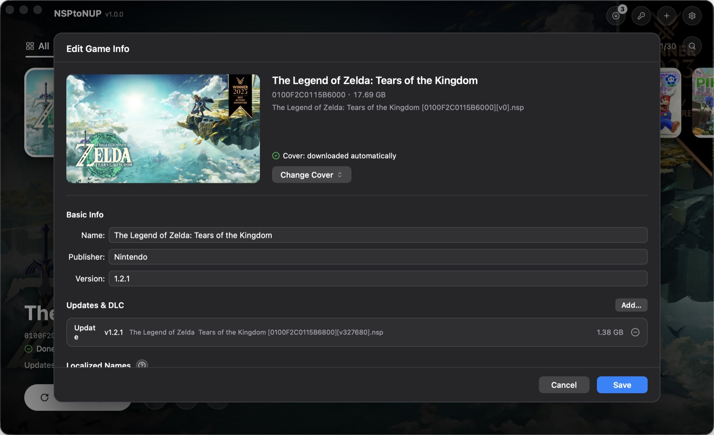
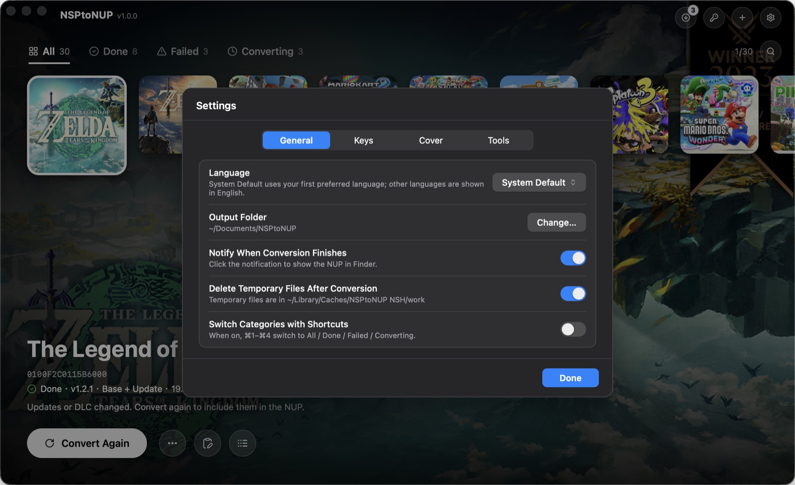

<div align="center">



# NSPtoNUP — Nintendo Switch NSP to NUP Converter

**Convert Nintendo Switch NSP files into NUP packages, with the base game, its update and DLC merged into one.**
Free and open source desktop app for macOS, Windows and Linux.

[](https://github.com/HereOrCode/Switch-Game-NSPtoNUP/releases/latest)
[](https://github.com/HereOrCode/Switch-Game-NSPtoNUP/releases)
[](LICENSE)
[](#download-and-install)

[**Website**](https://hereorcode.github.io/Switch-Game-NSPtoNUP/) ·
[**Download**](https://github.com/HereOrCode/Switch-Game-NSPtoNUP/releases/latest) ·
[Install](#download-and-install) ·
[Troubleshooting](#troubleshooting) ·
[Build from source](#building-from-source) ·
[Disclaimer](#disclaimer)



</div>

## What is NSPtoNUP?

NSPtoNUP is a desktop app that converts **Nintendo Switch NSP files** into **NUP**, the
unencrypted game container format of the [nup](https://github.com/a55uka/nup) project. Add your
NSP files or a whole folder, and NSPtoNUP identifies every **base game, update and DLC**, groups
them by game, and packs each game into a **single NUP file**: no command line, no manual
unpacking, no juggling of separate update and DLC files.

NSPtoNUP is useful when you want to:

- **Convert NSP to NUP** in a few clicks, one game at a time or a whole library in a queue
- **Merge a base game with its update and DLC** into one NUP package
- Read **updates in the newer BKTR format** directly from the NSP, without extracting them first
- Keep a tidy **Switch game library** with covers, game info and conversion status

> [!IMPORTANT]
> **NSPtoNUP does not include any keys, firmware or games, and does not help you obtain them.**
> You need your own `prod.keys` (and optionally `title.keys`) dumped from your own Nintendo Switch,
> and games you legally own. Please read the [Disclaimer](#disclaimer).

## Features

- **NSP to NUP conversion**: base game + update + DLC merged into one NUP
- **Smart import**: drop in NSP files or folders; content is identified and grouped by game automatically
- **Newer update formats**: BKTR updates are read straight from the NSP; nothing is unpacked to disk first
- **Conversion queue**: convert several games in a row and follow each one's progress
- **Game library**: covers fetched automatically, editable game name, publisher, version and cover
- **Private by design**: key files are never copied or uploaded, and key values never appear in command lines or logs
- **Verified output**: every NUP is verified after it is written
- **Cross-platform**: native app for macOS (Apple silicon), Windows (x64, ARM64) and Linux (x64, ARM64)
- **Three languages**: English, Japanese and Simplified Chinese

## Screenshots

<table>
  <tr>
    <td width="50%"></td>
    <td width="50%"></td>
  </tr>
  <tr>
    <td align="center"><b>Conversion queue</b>: convert several games and follow their progress</td>
    <td align="center"><b>Game info</b>: check the cover, name, version, update and DLC before converting</td>
  </tr>
  <tr>
    <td width="50%"></td>
    <td width="50%"></td>
  </tr>
  <tr>
    <td align="center"><b>Settings</b>: language, output folder, notifications and more</td>
    <td align="center"><b>Game library</b>: every game with its cover and status</td>
  </tr>
</table>

## Download and install

Download the package for your system from the
[latest release](https://github.com/HereOrCode/Switch-Game-NSPtoNUP/releases/latest).
`SHA256SUMS.txt` in each release lists the checksums.

| System | Package | Requirements |
|---|---|---|
| macOS (Apple silicon) | `NSPtoNUP-macos-arm64.zip` | macOS 14 Sonoma or later |
| Windows x64 | `NSPtoNUP-windows-x64.zip` | Windows 10 1809 or later, WebView2 Runtime |
| Windows ARM64 | `NSPtoNUP-windows-arm64.zip` | Windows 11 on ARM, WebView2 Runtime |
| Linux x64 | `NSPtoNUP-linux-x64.tar.gz` | GTK 4.14+, glibc 2.39+ (Ubuntu 24.04 or later) |
| Linux ARM64 | `NSPtoNUP-linux-arm64.tar.gz` | GTK 4.14+, glibc 2.39+ (Ubuntu 24.04 or later) |

### macOS

1. Download `NSPtoNUP-macos-arm64.zip` and double-click it to unzip.
2. Drag **NSPtoNUP.app** into your **Applications** folder.
3. The first time, **right-click** NSPtoNUP.app and choose **Open**, then confirm.
   (The app is not notarized by Apple; see [Troubleshooting](#macos-nsptonup-cant-be-opened-or-is-damaged).)

### Windows

1. Download the `.zip` for your PC (`x64` for most PCs, `arm64` for Windows on ARM devices).
2. Right-click the zip and choose **Extract All…** (don't run the app from inside the zip).
3. Open the extracted `NSPtoNUP` folder and run **NSPtoNUP.exe**.
   Keep the `tools` folder next to `NSPtoNUP.exe`; the app needs it.

### Linux

1. Download the `.tar.gz` for your machine (`x64` or `arm64`) and extract it:
   ```sh
   tar -xzf NSPtoNUP-linux-x64.tar.gz
   ```
2. Run the app:
   ```sh
   ./NSPtoNUP/NSPtoNUP
   ```
   Keep the `tools` folder inside the `NSPtoNUP` folder; the app needs it.

### First steps

1. Open **Settings › Keys** (or the key button at the top) and choose your `prod.keys`, plus
   `title.keys` if you have one.
2. Click **+** to add NSP files or a folder. Base games, updates and DLC are grouped together.
3. Click **Convert**. NUP files are saved to `Documents/NSPtoNUP` by default; you can choose
   another folder in **Settings › General**.

## Troubleshooting

### macOS: "NSPtoNUP can't be opened" or "is damaged"

NSPtoNUP is not notarized by Apple, so Gatekeeper blocks it the first time.

- Right-click **NSPtoNUP.app** › **Open** › **Open**, or
- Open **System Settings › Privacy & Security**, scroll down and click **Open Anyway**.

If macOS says the app **"is damaged and can't be opened"**, remove the download quarantine flag in
Terminal and open it again:

```sh
xattr -cr /Applications/NSPtoNUP.app
```

### Windows: "Windows protected your PC" (SmartScreen)

The app is not code-signed, so SmartScreen may warn you the first time. Click **More info** ›
**Run anyway**.

### Windows: the app doesn't start or the window stays blank

NSPtoNUP needs the **Microsoft Edge WebView2 Runtime**. It is built into Windows 11 and installed
with Microsoft Edge on Windows 10. If it is missing, install it from
[Microsoft's WebView2 page](https://developer.microsoft.com/microsoft-edge/webview2/).

### Antivirus quarantines `nxpatch` or `nup`

The bundled tools in the `tools` folder are self-contained executables, which some antivirus
products flag by mistake. Restore them and add the NSPtoNUP folder to your antivirus exceptions.
If a tool is missing, the app reports **"Bundled tool not found"**.

### Linux: the app doesn't start

- **`error while loading shared libraries: libgtk-4.so.1`**: install GTK 4, for example
  `sudo apt install libgtk-4-1` (Debian / Ubuntu) or `sudo dnf install gtk4` (Fedora).
- **`GLIBC_2.39 not found`**: your distribution is too old. Use Ubuntu 24.04, Fedora 40 or
  another distribution with glibc 2.39 or later.
- **`Permission denied`**: make the files executable with
  `chmod +x NSPtoNUP/NSPtoNUP NSPtoNUP/tools/*`.

### "No valid prod.keys is configured" or "prod.keys is missing …"

Choose your `prod.keys` in **Settings › Keys**. If a game reports that `prod.keys` is missing a
key, the game needs a newer firmware than your keys: dump `prod.keys` again from a console
updated to that firmware version.

### "No title key"

The NSP has no usable common ticket. Add a `title.keys` that contains the game's title key in
**Settings › Keys**.

### "This is an update" / "This is DLC. Add the base game instead."

Updates and DLC are converted together with their base game. Add the base game NSP (or the whole
folder) and NSPtoNUP attaches the update and DLC to it automatically.

### "This is an NSZ package"

NSPtoNUP reads NSP files only. Decompress NSZ files to NSP first.

### "Not enough disk space"

A conversion temporarily needs free space roughly the size of the game. Free up space on the drive
of the output folder, or choose an output folder on another drive. Turn on
**Settings › General › Delete Temporary Files After Conversion** to clean up automatically.

### NUPs made with 1.0.0 or 1.0.1 show no icon or name in other tools

NSPtoNUP 1.0.0 and 1.0.1 shipped a build of nup that numbered the NUP metadata records one off from
the [NUP spec](https://github.com/a55uka/nup/blob/meow/SPEC.md), so apps that follow the spec find
no icon and read the wrong name, version and publisher. 1.0.2 writes them correctly. Convert the
game again, or fix existing files in place in a few seconds (Python 3, no repacking):

```sh
python3 fix-nup-tlv.py --dry-run ~/Documents/NSPtoNUP   # check only
python3 fix-nup-tlv.py ~/Documents/NSPtoNUP             # fix every .nup in the folder
```

Download [`fix-nup-tlv.py`](NSPtoNUP%20NSH/scripts/fix-nup-tlv.py) from this repository. Files that
are already correct are skipped.

Still stuck? Open the **Conversion Log** of the game (the list button below the game title) and
include it when you [open an issue](https://github.com/HereOrCode/Switch-Game-NSPtoNUP/issues).

## FAQ

**What is the NUP format?**
NUP is an unencrypted container format for Nintendo Switch game dumps, defined by the
[nup](https://github.com/a55uka/nup) project. NSPtoNUP reads NSP files and packs their content into NUP.

**Can NSPtoNUP merge updates and DLC into the base game?**
Yes. A base game, its update (one, the newest) and all of its DLC become a single NUP file.

**Does NSPtoNUP support NSZ, XCI or XCZ?**
No, only NSP. Convert or decompress other formats to NSP first.

**Is NSPtoNUP free?**
Yes. It is free and open source under the [MIT License](LICENSE).

---

## Building from source

NSPtoNUP is built with [NSH](https://nsh.dev) (Native Shell): the interface is written in TSX and
the conversion logic in a Rust crate. It bundles two command-line tools:

- **nxpatch** (`tools/nxpatch`): reads and decrypts NSP files, built on
  [LibHac](https://www.nuget.org/packages/LibHac) with .NET
- **nup**: writes and verifies NUP packages, built from [a55uka/nup](https://github.com/a55uka/nup)
  with PyInstaller

### Repository layout

```
NSPtoNUP NSH/      The app: App.tsx, ui/ (TSX), src/ (Rust), locales/, scripts/
tools/nxpatch/     nxpatch source (C#, LibHac)
docs/              Website (GitHub Pages)
.github/workflows/ Release builds for every platform
```

### Requirements

- [NSH 0.5.1](https://nsh.dev/docs/installation) and its platform requirements
  (GTK 4 development packages on Linux; Visual Studio Build Tools and LLVM on Windows)
- Rust via [rustup](https://rustup.rs) (the version is pinned in `rust-toolchain.toml`)
- [.NET SDK 11](https://dotnet.microsoft.com/download) for nxpatch
- [uv](https://docs.astral.sh/uv/) and git for nup

### Build and run

```sh
cd "NSPtoNUP NSH"
scripts/fetch-tools.sh          # build nxpatch and nup for this platform into tools/<platform>/
scripts/dev.sh                  # run in development mode (macOS); --mock shows demo data
nsh check                       # type check + cargo check
cargo test                      # Rust unit tests
```

On Windows, run `scripts/fetch-tools.sh` in Git Bash. nup is packaged with PyInstaller, which
can't cross-compile, so build the tools on the platform you are packaging for.

### Package

```sh
scripts/package-macos.sh --zip  # macOS: .nsh/out/NSPtoNUP.app and NSPtoNUP-macos-<arch>.zip
scripts/package-linux.sh        # Linux: .nsh/out/NSPtoNUP-linux-<arch>.tar.gz
scripts/package-windows.ps1     # Windows: .nsh/out/NSPtoNUP-windows-<arch>.zip
```

See [`NSPtoNUP NSH/README.md`](NSPtoNUP%20NSH/README.md) for development details: interface
languages, data locations and tests.

### Releases

Pushing a tag `v<version>` that matches `version` in `NSPtoNUP NSH/nsh.json` runs
[`.github/workflows/release.yml`](.github/workflows/release.yml). It builds all five packages on
GitHub Actions and publishes them as a GitHub Release. Running the workflow manually builds the
packages without publishing.

## Disclaimer

- **No affiliation.** NSPtoNUP is an independent, unofficial project. It is not affiliated with,
  endorsed, sponsored or approved by Nintendo Co., Ltd. or any of its subsidiaries.
- **Trademarks.** Nintendo Switch and other names, logos and game titles are trademarks of their
  respective owners and are used only to describe compatibility. Game covers shown in the
  screenshots are the property of their respective owners and appear only to illustrate the app.
- **No copyrighted content.** NSPtoNUP does not contain, distribute or download any Nintendo
  firmware, cryptographic keys, games or other copyrighted content, and it provides no way to obtain
  them. Requests for keys, firmware or games will not be answered, and such issues will be closed.
- **Lawful use only.** NSPtoNUP is intended solely for converting backups of games you legally own,
  using keys dumped from a console you own. You are solely responsible for making sure that your
  use complies with the laws of your country, including copyright and anti-circumvention laws, and
  with any agreements that apply to you. The authors do not condone piracy.
- **No warranty.** NSPtoNUP is provided "as is", without warranty of any kind, as stated in the
  [MIT License](LICENSE). The authors and contributors are not liable for any damages arising from
  its use, including data loss, corrupted files, damage to hardware, or account or console bans.
  Keep your own backups before converting.
- **Third-party software.** NSPtoNUP bundles third-party tools (nxpatch built on LibHac, and nup),
  each under its own license; see [THIRD_PARTY_NOTICES.md](THIRD_PARTY_NOTICES.md).

By downloading or using NSPtoNUP, you acknowledge that you have read and agree to this disclaimer.

## License

NSPtoNUP is released under the [MIT License](LICENSE). Third-party components and their licenses
are listed in [THIRD_PARTY_NOTICES.md](THIRD_PARTY_NOTICES.md).
